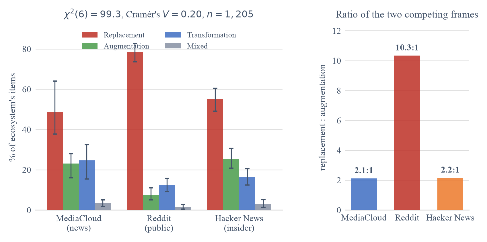
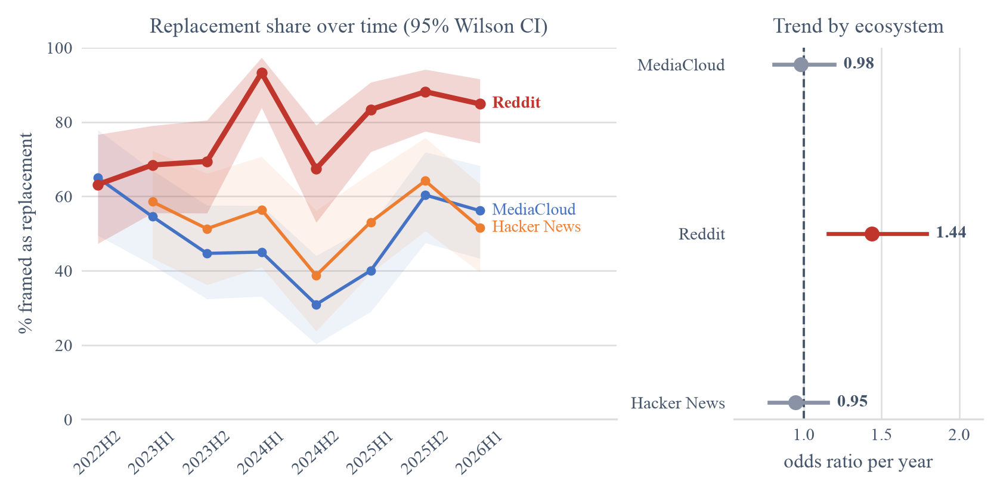
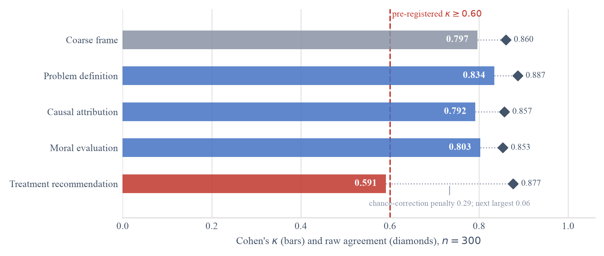

# From Augmentation to Replacement

**How is AI's effect on jobs described, and does that description depend on where the conversation happens?**

MSc Data Science dissertation, University of Exeter. Supervisor: Dr Chico Camargo.

I built a validated LLM coding pipeline, applied it to 40,735 items from three
online discourse ecosystems, and measured how each one frames the relationship
between AI and work across 2022–2026.

---

## Headline result

News media and a technical forum describe AI's labour impact almost identically.
The general public does not, and the gap is widening.



Replacement-to-augmentation ratios: **2.1:1** in news, **2.2:1** on Hacker News,
**10.3:1** on Reddit. χ²(6) = 99.3, Cramér's *V* = 0.20, *n* = 1,205.

Over time, the pooled trend is null. Split by source, only Reddit moves, rising
1.44× per year while augmentation framing falls at close to the reciprocal rate.
One frame displaces the other, and only among the general public.



The finding I did not expect: replacement is the most common frame and the least
prescriptive one. 81.6% of replacement-framed items recommend no course of
action at all, and the cause they name is almost always "technology" rather than
any actor who could be held responsible.

---

## What this project involved

**Retrieval at scale.** 328,270 API responses from three sources with
incompatible query models, reduced to a 40,735-item corpus by a single
inclusion rule applied identically to all three in my own code. Checkpointed and
resumable, with adaptive rate limiting after one backend went down mid-collection.

**An LLM as a measurement instrument, not a shortcut.** `claude-opus-5` codes
every item under a versioned codebook, with structured outputs constraining each
field at decode time so an invalid label cannot be produced. I hand-coded 300
items blind to test it, against a reliability threshold fixed in advance.

**The validation gate passed on three of four functions.**



Cohen's κ = 0.797 on the overall frame. Treatment recommendation falls below the
line at 0.591 while having the second-highest raw agreement of any field — the
kappa paradox, caused by four-fifths of items recommending nothing. I report
both numbers rather than the flattering one.

**A cross-check that disagreed, usefully.** A second model from a different
provider agreed at only κ = 0.503. Rather than discard it, I traced why: it
scores each category independently and takes the maximum, so it cannot express a
balanced judgement and returned almost no MIXED items. A diagnosable limitation
is more informative than silent agreement.

**Reproducibility enforced by code.** Every figure recomputes its values when
built; none contains a typed-in number. The analysis notebook ends by
recomputing all 36 published values and raising an error if any no longer
matches the write-up.

---

## Repository

```
notebooks/
  01_data_pipeline.ipynb        corpus construction, stage by stage
  02_analysis_and_results.ipynb every reported result, ending in a 36-value check
src/
  analysis.py                   loading and statistics used by the analysis
  retrieve_*.py, harvest_*.py   retrieval across the three APIs
  filter_clean.py               the single inclusion rule and cleaning order
  code_frames*.py               the primary and cross-check coders
  validate_coding.py            the reliability gate
codebook/                       the coding instrument, and the prompt given to the model
figures/                        all seven report figures
data/                           codes and validation outputs (see data/README.md)
```

Both notebooks are committed with outputs, so everything can be read without
running anything.

**Stack:** Python 3.14, pandas, scikit-learn, statsmodels, SciPy, BERTopic,
sentence-transformers, VADER, matplotlib. Anthropic and OpenAI APIs for coding.

**Methods:** Cohen's κ and Krippendorff's α, χ² with Cramér's V and standardised
residuals, Monte-Carlo permutation χ² where expected counts are small, cluster
bootstrap resampling authors rather than items, logistic regression with
cluster-robust standard errors, Holm correction, PELT change-point detection,
Kruskal–Wallis, and log-odds with an informative Dirichlet prior.

---

## Two things worth saying plainly

**I found two defects in my own pipeline before they reached the results.** A
substring match meant the token `ai` was matching inside *said*, *email* and
*available*, mis-tagging most harvested posts. Separately, one query group had
never run against part of the subreddit list, which produced a large apparent
difference between frame groups that I had started writing up as a finding
before recognising it as an artefact of my own retrieval. Both are documented in
the write-up rather than quietly corrected.

**The corpus is not in this repository**, and
[`data/README.md`](data/README.md) explains why. The short version: the metadata
pairs post URLs with author identifiers, and much of the material is people
describing losing their jobs.

---

## Licence

MIT for the code. The corpus is not redistributed.
